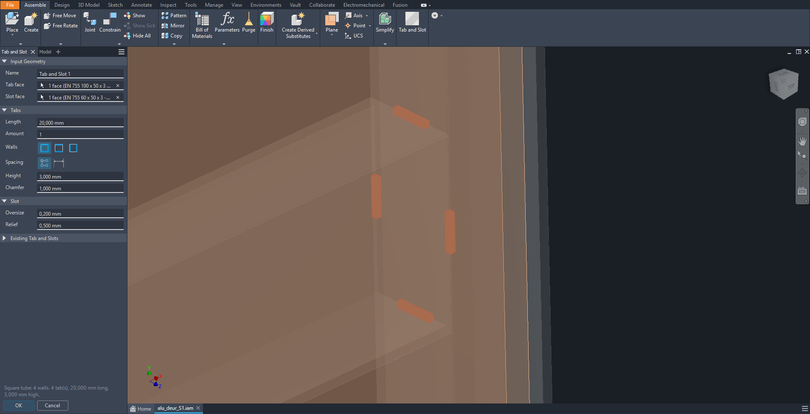
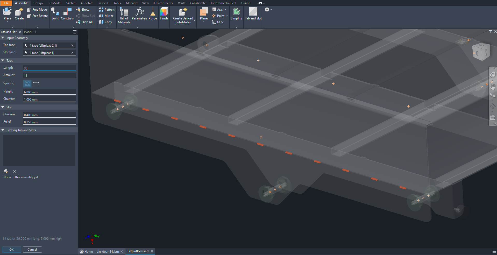

# Inventor Tab and Slot

Small Autodesk Inventor add-in that makes tabs on one part and matching slots in another, right inside an assembly.
It adds a **Tab and Slot** button to the Assemble tab and a dockable panel in Inventor's own style that follows your theme.

**Square tube into tube**: tabs on all four walls, with the height set to the wall thickness.



**Sheet metal**: tabs along a sheet edge, slotted into the plate below.



## Features

- **One panel for everything**: create new tab and slot sets, and edit or delete existing ones.
- **Sheet metal**: tabs are made as Face features and slots as Cut features, so flat patterns stay correct.
- **Square tubes**: pick a tube end (or its edge) and tabs are placed on all four walls, or on one pair of opposite walls in either direction.
- **Plates and profiles**: normal parts get extruded tabs, and slots are cut only through the wall they go into.
- **Easy picking**: two clicks, one for the tab face or edge and one for the slot face. Components turn see-through while you pick, and clicking the same spot again quickly selects the face behind it.
- **Shop rules built in**, all filled in automatically. Type a value in a field to override it, or clear the field to go back to the automatic value.
  - **Tab height**: the thickness of the plate or wall the tab goes into.
  - **Slot oversize**: from the ISO 9013 cutting tolerance table, based on plate thickness and tab length.
  - **Corner relief holes**: diameter from plate thickness. Up to 3 mm: 1.0 mm. Up to 6 mm: 1.5 mm. Up to 12 mm: 2.0 mm. Thicker: 4.0 mm.
- **Chamfered tabs**: optional tip chamfer, 1 mm by default.
- **Layout**: set the tab length and amount, with equal spacing or a fixed pitch.

## Requirements

- Windows with Autodesk Inventor 2025 (the add-in runs on .NET 8)
- [.NET 8 SDK](https://dotnet.microsoft.com/download/dotnet/8.0) to build it

## Building

The project references `Autodesk.Inventor.Interop.dll` from the Inventor installation at
`C:\Program Files\Autodesk\Inventor 2025\Bin\Public Assemblies`. If Inventor is installed somewhere else, change the `HintPath` in `TabSlotAddIn.csproj` to match.

```powershell
git clone https://github.com/JanTrueno/Inventor-Tab-and-Slot.git
cd Inventor-Tab-and-Slot
dotnet build TabSlotAddIn.csproj -c Release
```

The output goes to `bin\Release\net8.0-windows\`: `TabSlotAddIn.dll`, `.pdb` and `.deps.json`. You can also open `TabSlotAddIn.csproj` in Visual Studio 2022 and build it there.

`tests\CoreTests.csproj` is a small development harness that drives a running Inventor through COM. You don't need it to build or use the add-in.

## Install

The easiest way is the installer: download `TabSlot-Setup-<version>.exe` from [Releases](https://github.com/JanTrueno/Inventor-Tab-and-Slot/releases) and run it.
It installs for the current user without admin rights, and you can uninstall it from Windows **Settings → Apps**.

### Building the installer

You need [Inno Setup 6](https://jrsoftware.org/isinfo.php). Install it with `winget install JRSoftware.InnoSetup`, then run:

```powershell
powershell -ExecutionPolicy Bypass -File build-installer.ps1
```

This builds the add-in and writes `dist\TabSlot-Setup-<version>.exe`. The version comes from `deploy\PackageContents.xml`, or you can pass `-Version 1.2.0`.

### Installing from source

Close Inventor (it locks the add-in DLL while running), then run:

```powershell
powershell -ExecutionPolicy Bypass -File install.ps1
```

This builds the add-in and installs it as an app bundle in `%APPDATA%\Autodesk\ApplicationPlugins\TabSlotManager.bundle`.
Start Inventor, open an assembly, and click **Assemble → Tab and Slot**.

- `install.ps1 -SkipBuild` installs the last build without building again.
- `install.ps1 -Remove` uninstalls it.

## Usage

1. Click **Tab and Slot**.
2. Pick the face or edge the tabs grow from: the edge face of a sheet, or the end of a tube.
3. Pick the face the slots are cut into.
4. Adjust the values if needed and check the preview, then click **OK**.

Existing sets are listed under **Existing Tab and Slots**, where you can edit or delete them.

Right-click a toggle icon or an Edit/Delete icon to choose a different Inventor icon for it.

A log is written to `%LOCALAPPDATA%\TabSlotAddIn\log.txt`.

## License

GPL-3.0, see [LICENSE](LICENSE). Some interface icons come from Autodesk Weave (Apache-2.0), see [THIRD-PARTY-NOTICES.txt](THIRD-PARTY-NOTICES.txt).
